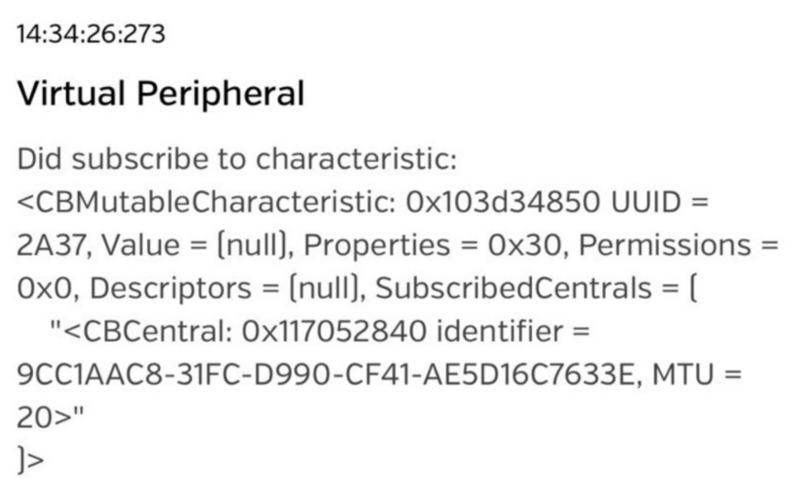

# BLE Central with CCCD Setting

A Python BLE Central on Raspberry Pi 3 that connects to a phone acting as a BLE Peripheral (GATT Server) and writes its CCCD to enable indications. Completes the **Basic Problem**.

### Behavior

1. **Scan**: the RPi scans for 1 s and lists nearby devices with their address, address type, RSSI, and advertising data.
2. **Connect**: the user picks a device by number, and the RPi connects to it and lists all of its GATT services.
3. **Find the CCCD**: in the Heart Rate Service (`0x180D`), the program locates the Heart Rate Measurement characteristic (`0x2A37`) and searches its descriptors for the CCCD (`0x2902`).
4. **Write the CCCD**: the program writes `0x0002` to the CCCD to enable indications.
5. **Receive data**: the program waits for indications or notifications and prints the handle and the data in hex. When interrupted, it disconnects from the phone.

The phone's server log in the BLE app confirms that the CCCD was written.

### Hardware and Environment

| Item | Value |
|---|---|
| Central (GATT Client) | Raspberry Pi 3 |
| Peripheral (GATT Server) | iphone running a BLE peripheral app(LightBlue) with a Heart Rate Service |
| Language | Python 3 |
| BLE library | bluepy (on top of BlueZ) |

### Source Code

All logic is in **`ble_scan_connect.py`**. Run it with `sudo`, since BLE scanning needs root privileges:

```bash
sudo python3 ble_scan_connect.py
```

### CCCD

The CCCD (Client Characteristic Configuration Descriptor, UUID `0x2902`) is a descriptor attached to a characteristic. The client writes it to tell the server whether to push value updates:

| Value | Meaning |
|---|---|
| `0x0000` | Disabled |
| `0x0001` | Notification (no acknowledgment from the client) |
| `0x0002` | Indication (the client must acknowledge each update) |

BLE stores multi-byte values in little-endian order, so `0x0002` is written as the bytes `[0x02, 0x00]`.

The CCCD has no fixed handle; it usually sits right after the characteristic's value attribute. So the program looks for it among the descriptors between the characteristic's handle and the end of the service, instead of hard-coding a handle.

